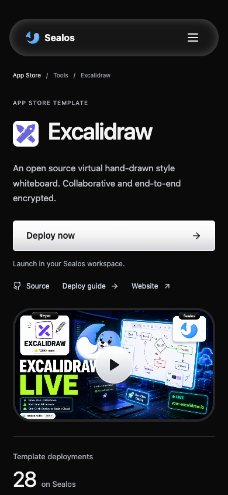
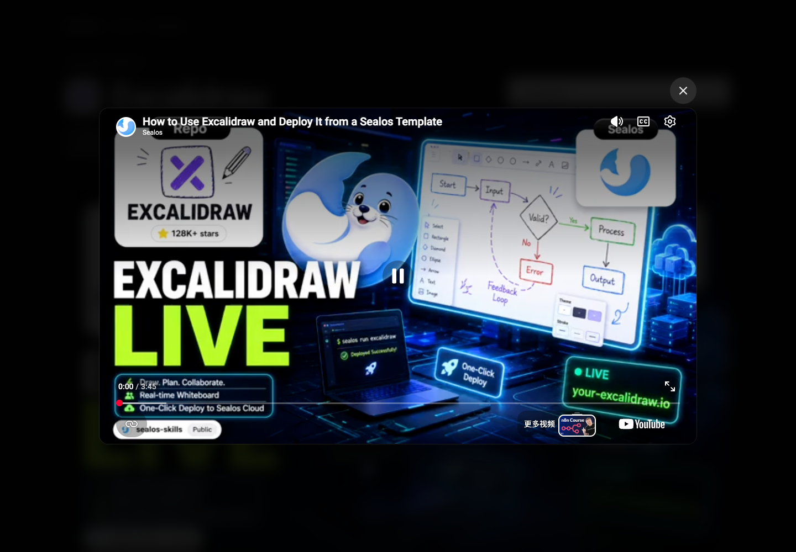

# Template Video verification

Issue: https://github.com/labring/sealos.io/issues/357

Date: 2026-09-29 (Asia/Shanghai). Baseline: `ace53cd`.
Environment: Node 20.20.0, pnpm 10.28.2, installed TypeScript 5.8.3,
Chrome 153 via the existing Playwright installation. No dependencies added.

## Historical player style

The style update starts from `84f1be7` and follows the homepage player at
`226c1a0697e84885d099ce48fbaa7494e6deaf77`, the first parent of PR #298's merge.
The reference components are `DemoSection.tsx` and `VideoModal.tsx` under
`app/[lang]/(home)/(new-home)/`, plus the historical `landing-primary` button.

The approved scope restores the 16:9 cover, 32px corners, 4px dark border,
64px white-to-gray round play button, and responsive modal playback. The cover
stays flat. Each template keeps its own video and thumbnail.
The modal uses the existing Radix dependency and CSS transitions, with a dark
blurred backdrop, 16px video corners, and an external close button. Its width is
capped by viewport height so the close button fits landscape phones.

Mouse close, backdrop close, and Escape with host-dialog focus unload the
iframe and restore focus to the cover. Cross-origin YouTube controls retain
their own keyboard events: use Tab/Shift+Tab to return to the close button
after interacting inside the player. Chrome also retains this focus boundary
with a native HTML `dialog`; the historical Radix player has the same boundary.
Reduced-motion preferences disable the modal transitions.

The thumbnail-quality follow-up starts from `7e6ffcf`. Covers prefer
`maxresdefault.jpg` (1280×720), with one fallback to `hqdefault.jpg` (480×360)
on an image load error. A failed fallback keeps the named play control usable
without retrying the image indefinitely. The image ref also checks for a
completed failure before hydration, when the original error event was missed.

The caption-removal follow-up starts from `b389a16`. Video previews omit the
entire caption row; screenshot and identity previews retain their captions.
Typechecking and fixture browser acceptance passed (6 passed, 1 production-only
skip); the full suite retained its three documented baseline failures. The
mobile screenshot was refreshed. Production build results below refer to the
historical-style revision `7e6ffcf`.

## Data and publishing

- The existing template-list endpoint returned 250 templates. Its existing
  eligibility rules retained 224; eight supplied `spec.youtube`.
- Backfilled the committed catalog using `templateName || slug`. A deep
  comparison with the baseline, excluding `youtube`, confirmed identical
  ordering and all other fields. Template source files and icons stayed intact.
- Both converters retain trimmed, nonempty strings. The deterministic route
  tests exercise default, English, and Chinese API params, draft/locale
  eligibility, invalid metadata types, and the real committed-data fallback.
- The production English API export contains 224 templates and eight videos.
  The upstream `language=zh-cn` response currently contains 34 eligible
  templates and zero supplied videos; existing language filtering is preserved.
  Chinese detail pages use the shared committed catalog and display the same
  videos as English detail pages.
- The build revealed an existing default-API export gap: Next 14 emits
  `/api/apps/en` and `/api/apps/zh-cn`, while the empty optional catch-all
  params produce no default artifact. Nginx, Cloudflare, and Vercel now alias
  `/api/apps` and `/api/apps/` to the existing English artifact. Real local
  Nginx requests, including a query-string variant, returned HTTP 200 JSON
  deeply equal to that exported response. Hosted deployment was not performed.

## Rendered-page acceptance

`app-store-video-browser.test.mjs` uses the real detail route with controlled
external thumbnail and player responses. Its fixture mode starts a loopback-only
Next server from a temporary copy of application code/configuration. Catalog
fixtures never modify the working catalog.

Verified on Excalidraw, Open WebUI, and Eaglercraft in English and Chinese,
at 1440×1000, 390×844, and 844×390 viewports:

- A 16:9 thumbnail cover precedes the player; initial feature requests contain
  no player request. Mouse, Enter, and Space open a named modal containing one
  fixed-host privacy-enhanced iframe requesting autoplay.
- The cover retains its dimensions, video and close controls fit the viewport,
  keyboard focus starts at Close video and can enter/leave the iframe, and
  fullscreen permission is present. Closing removes the iframe and returns
  focus to the cover; reopening and backdrop dismissal work. Video previews
  omit the caption and its YouTube/full-screenshot links.
- Eaglercraft keeps the world illustration, Day control, deployment dialog,
  and the existing language-appropriate guide.
- Failed thumbnails keep the named play control usable. Restricted iframe
  requests retain modal dismissal and the cover play control.
- Fresh n8n and legacy `Reactive-Resume` visits retain screenshot previews.
- 36 fixture combinations exercise accepted watch/short links, absent/blank/
  non-string values, malformed/foreign/spoofed URLs, credentials, HTTP,
  unsupported paths/ports, and invalid IDs, with and without screenshots.
- The previous production export passed the JavaScript-disabled content check.
  The updated check expects the video cover, page title, and guide; it awaits
  the next production build. Dev streaming is tested separately.





## External playback

The HTTP-served production export was tested separately with real YouTube
requests on 2026-09-29. All three player documents loaded and began playback:

| Template    | Video ID      | Observed playback                                     |
| ----------- | ------------- | ----------------------------------------------------- |
| Excalidraw  | `-tuMrj63-6g` | `currentTime > 0`, `paused = false`, `readyState = 4` |
| Open WebUI  | `x-NrQq3C84Q` | `currentTime > 0`, `paused = false`, `readyState = 4` |
| Eaglercraft | `6ANuRL-c5Fs` | `currentTime > 0`, `paused = false`, `readyState = 4` |

The poster-quality follow-up was checked against the isolated Next preview.
All three representative templates loaded 1280×720 `maxresdefault.jpg` covers;
Excalidraw's cover was inspected at desktop/mobile widths. Browser regression
checks cover a missing high-resolution image and failure of both image sizes.
Upstream video availability and browser autoplay policy remain external
conditions.

## Checks

- `pnpm lint`: passed.
- `pnpm build` with English default locale and `https://sealos.io` app URL:
  passed; 6,259 static pages and the existing AI FAQ route verifier passed.
- `pnpm app-store:diff --allow-changes`: passed; 224 apps/source entries,
  only the reviewed catalog video additions.
- Focused catalog/API tests, default API HTTP regression, deployment parity,
  static route checks, and legacy App Store SEO checks: passed.
- Production browser acceptance: passed. Fixture browser acceptance: passed.
  Each mode intentionally skips the check owned by the other mode.
- Full suite: 306 tests; 298 passed, 3 failed, 5 environment-gated browser
  checks skipped. Existing `.mts`/`.ts` tests were transpiled in memory using
  the installed compiler to run under Node 20. The video browser checks above
  were executed separately with their preview environment configured.
- All three full-suite failures were reproduced against baseline `ace53cd`:
  Footer and Header source-text assertions expect the App Store URL without
  its existing trailing slash; the existing Eaglercraft architecture article
  test expects the absent sentence “Set up an owned domain in three steps:”.
- Independent standards/spec reviews found no outstanding production issue.
  The historical-style update passed both reviews, with the cross-origin
  keyboard boundary documented above. Real YouTube playback, landscape fit,
  and reduced-motion behavior were checked against its production export.
  Test fixture isolation, loopback binding, and signaled-process cleanup
  findings were addressed before final verification.

## Repeat focused checks

```sh
pnpm exec node --test scripts/generate-apps-api.test.mjs scripts/apps-api-video.test.mjs scripts/app-store-nginx.test.mjs
pnpm lint
pnpm app-store:diff --allow-changes
NEXT_PUBLIC_DEFAULT_LOCALE=en NEXT_PUBLIC_APP_URL=https://sealos.io pnpm build
```

Set `PLAYWRIGHT_MODULE` to an existing Playwright installation and
`BROWSER_CHANNEL=chrome` when using installed Chrome. Against an HTTP-served
production export, run:

```sh
APP_STORE_PREVIEW_URL=http://127.0.0.1:3573 pnpm exec node --test scripts/app-store-video-browser.test.mjs
```

For isolated data fixtures, supply a free loopback port; the test owns the
server and its temporary files:

```sh
APP_STORE_PREVIEW_URL=http://127.0.0.1:3572 APP_STORE_VIDEO_FIXTURES=1 pnpm exec node --test scripts/app-store-video-browser.test.mjs
```
